### AI Automation · RAG · Machine Learning

I build AI-assisted workflows, document Q&A systems, and machine learning projects using **Python, n8n, Gemini, and Supabase**. My work focuses on input validation, retrieval, and handling failures clearly.

BS Computer Science student · Islamabad, Pakistan

### [Explore All Projects →](https://saadkabeer.online)

[Connect on LinkedIn](https://bit.ly/linkedinSaadkabeer)

---

## Selected projects

### 01 / AI Lead Qualification & Follow-up

An n8n workflow that qualifies inquiries, checks AI-generated email drafts, and records outcomes. A companion error handler distinguishes failures before, during, and after email sending.

**n8n · Gemini · Gmail · Google Sheets**

[Read the case study →](https://saadkabeer.online/projects/ai-lead-qualification-and-follow-up) &nbsp; · &nbsp; [Explore the workflow](https://github.com/saad-khanzada/n8n-Automation-Projects/tree/main/AI-Lead-Qualification-Followup)

### 02 / RAG Document Q&A Agent

A document Q&A prototype that retrieves relevant PDF passages from Supabase before generating an answer with Gemini. Includes documented recovery, embedding migration, and a verified factual test example.

**n8n · Gemini · Supabase pgvector · Google Drive**

[Read the case study →](https://saadkabeer.online/projects/rag-document-qa-agent) &nbsp; · &nbsp; [Explore the workflow](https://github.com/saad-khanzada/n8n-Automation-Projects/tree/main/AI-RAG-Agent)

### 03 / Titanic Survival Classification

A Python classification project using preprocessing pipelines, cross-validation, model comparison, and held-out evaluation. Documents both the results and the selected model’s limitations.

**Python · scikit-learn · Pandas · NumPy**

[Read the case study →](https://saadkabeer.online/projects/titanic-survival-classification) &nbsp; · &nbsp; [Explore the notebook](https://github.com/saad-khanzada/machine-learning-projects/tree/main/titanic-survival-classification)

---

## Tools & methods

**Automation**  
n8n · REST APIs · Webhooks · Google Workspace integrations

**Generative AI & retrieval**  
Gemini · Structured outputs · Embeddings · RAG · Supabase pgvector

**Machine learning**  
Python · Pandas · NumPy · scikit-learn · Preprocessing · Model evaluation

---

### Let’s connect

Open to junior AI/ML and AI automation roles, internships, and focused automation projects.

**[Explore All Projects →](https://saadkabeer.online)** &nbsp; · &nbsp; [LinkedIn](https://bit.ly/linkedinSaadkabeer)
